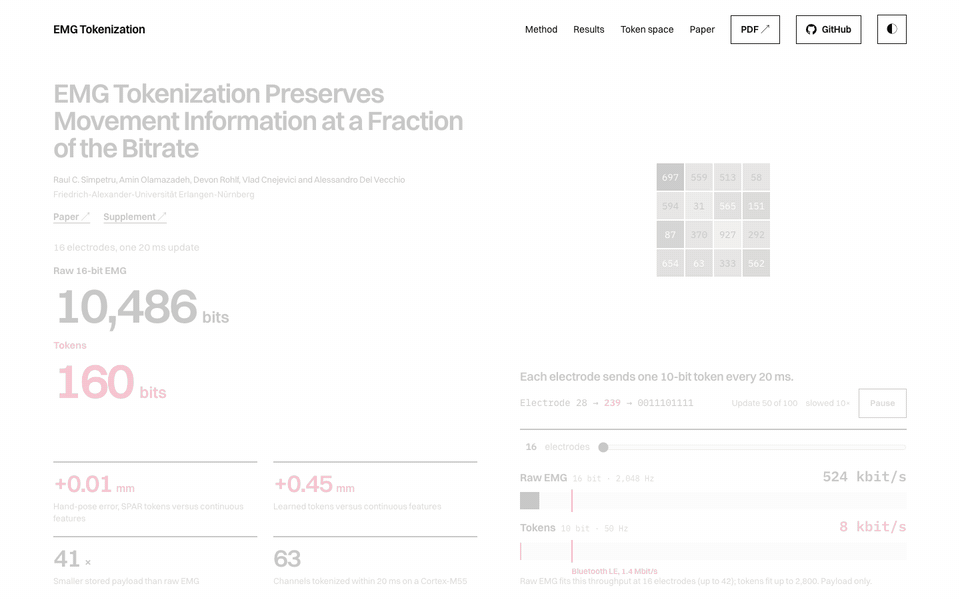

# MyoJi

<a href="https://nsquaredlab.github.io/MyoJi/">
  <picture>
    <source media="(prefers-color-scheme: dark)" srcset="docs/project-page-dark.gif">
    
  </picture>
</a>

MyoJi is tokenization for EMG. The name joins *myo* (muscle) and *emoji*. Like an emoji, each
token is one small symbol that stands for a whole pattern, here 20 ms of one electrode's EMG.

This repository holds the code for *EMG Tokenization Preserves Movement Information at a Fraction
of the Bitrate* (Sîmpetru, Olamazadeh, Rohlf, Cnejevici and Del Vecchio). Each electrode sends one
10-bit token (1,024 codes) every 20 ms in place of raw EMG, and the 3D hand pose is decoded from
the tokens. Two causal tokenizers, both fitted without pose labels, make the tokens:

- **SPAR** describes each electrode's spectrum and its coupling to the neighbouring electrodes
  (18 values per update). A k-means codebook maps these values to a token.
- **The learned tokenizer** is a per-channel encoder (160 ms patches, 480 ms causal context),
  pretrained to reconstruct each patch's log-power spectrum. Each output is mapped to the
  nearest of 1,024 code vectors.

The library is `myoji`. Project page: <https://nsquaredlab.github.io/MyoJi/>, built from
[`website/`](website/) by [`.github/workflows/website.yml`](.github/workflows/website.yml).

You need Python 3.12 or newer and [uv](https://docs.astral.sh/uv/). From the repository root:

```bash
uv sync                  # the library
uv run pytest            # no data needed
```

## The 60-second version

```python
import numpy as np
from myoji.codebook import fit_codebook, fit_standardization, standardize, tokenize
from myoji.preprocessing import normalize_raw
from myoji.spar import grid_layout, spar_simple_dataset_batched

# emg: (channels, samples) at 2 kHz; 320 channels in the paper's montage. A random stand-in here:
emg = np.random.default_rng(0).standard_normal((320, 8000))
x = normalize_raw(emg)                                   # calibrate on the first 500 ms, clip at ±12
ends = np.arange(2039, x.shape[1], 40)                   # one update every 20 ms
windows = x[:, ends[:, None] - np.arange(319, -1, -1)].transpose(1, 2, 0)   # 160 ms each

layout = grid_layout()        # three 8x8 and two 13x5 grids; pass your own grid maps otherwise
features = spar_simple_dataset_batched(windows, layout=layout, channelwise=True)  # (updates, channels, 18)

d = features.transpose(1, 0, 2)[None]                    # (windows, channels, updates, 18)
mask = np.tile(layout.mask, (1, 6))                      # absent boundary couplings
mean, scale = fit_standardization(d, mask)               # training windows only
book, _ = fit_codebook(standardize(d, mean, scale, mask), vocabulary=1024)
tokens = tokenize(standardize(d, mean, scale, mask), book)   # uint16, (windows, channels, updates)
```

The learned tokenizer runs from a checkpoint you train with `paper/pretraining`
([Training your own models](#training-your-own-models)):

```python
from myoji.learned import Tokenizer

tokenizer = Tokenizer("tokenizer.pt")
tokens = tokenizer.encode(emg, sample_rate_hz=2000)["tokens"]   # per channel, from 980 ms on
stream = tokenizer.stream(sample_rate_hz=2000)                    # or chunk by chunk: stream.push(chunk)
```

`myoji.decoders` holds the pose decoders for tokens or continuous features. `SparPose` is the
paper's spatial CNN + TCN. `CachedPoseDecoder` uses geometry-aware channel attention with an
optional causal TCN or Transformer.

## With MyoGestic

[MyoGestic](https://github.com/NsquaredLab/MyoGestic) pipelines can use SPAR descriptors or
tokens as features. This example extracts descriptors:

```python
from myoji import myogestic as tokens

@pipeline.extract
def extract(windows):
    return tokens.spar_descriptors(windows["emg"], fs=2048, layout=LAYOUT)  # Stream(window_ms=tokens.WINDOW_MS)
```

`tokens.SparCodebook` fits the codebook inside `@pipeline.train`. `tokens.learned_tokens` gives
learned tokens from a trained `Tokenizer`. `examples/myogestic_tokens.py` classifies Rest and Fist
from SPAR tokens of simulated EMG and drives the Virtual Hand:
`uv sync --extra myogestic && uv run python examples/myogestic_tokens.py`.

## Reproducing the paper

`paper/` holds the experiments and figure scripts behind the article and its supplement:
- `paper/hdemg`, `paper/receivers`, `paper/emg2pose`, `paper/pretraining`: the campaigns and statistics;
- `paper/figures`: the figure panels;
- `paper/embedded`: the Cortex-M55 SPAR firmware;
- `paper/data`: the frozen window selections and Supplementary Data 1–9.

Start at [`paper/README.md`](paper/README.md). The HD-EMG recordings are available from the
authors on reasonable request; emg2pose is public.

Supplementary Data 1–9 hold every plotted value and summary result. Fig. 7 and Supplementary
Figs. S1–S3 redraw directly from the shipped files; the other figures redraw from the campaign
outputs.

## Training your own models

1. Pretrain a learned tokenizer on the HD-EMG and emg2pose training windows, with the data
   folders set as in [`paper/README.md`](paper/README.md#setup):

   ```bash
   uv sync --group paper
   uv run python -m paper.pretraining.train_mixed_sources --output tokenizer-full.pt
   ```

   The defaults make a short test run. For the paper's tokenizer, pass the training arguments in
   `paper/data/reference/tokenizer_recipe.json`.

2. Export the checkpoint in the format `Tokenizer` loads:

   ```python
   from pathlib import Path
   from myoji.learned import export_checkpoint

   export_checkpoint(Path("tokenizer-full.pt"), Path("tokenizer.pt"), calibration_samples=1000)
   ```

3. Fit the SPAR codebooks and the pose decoders with the campaigns in `paper/`
   ([`paper/README.md`](paper/README.md#order)).

## Licence and citation

AGPL-3.0-or-later; vendored third-party code keeps its licence ([THIRD_PARTY.md](THIRD_PARTY.md)).
If you use myoji, please cite the paper, [arXiv:2610.32674](https://arxiv.org/abs/2610.32674) ([CITATION.cff](CITATION.cff)).
